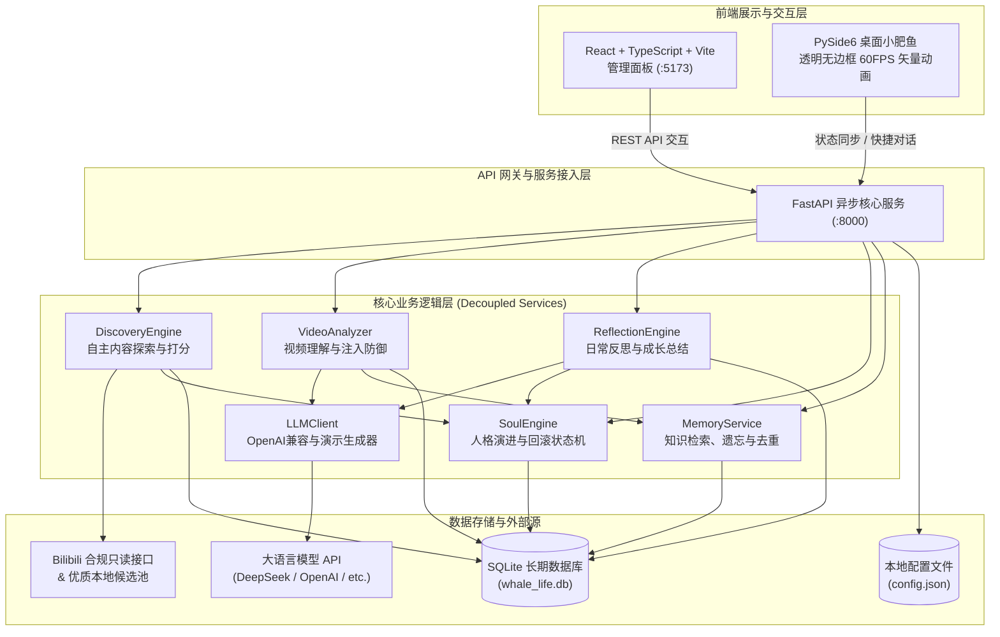

# 系统架构设计规范 (ARCHITECTURE.md)

本文档面向所有参与开发或接手的工程师与 AI Agent，全面解析 `BlueWhaleLife`（大肥鱼的B站生活）的系统架构、数据流向、安全防御与数据库规范。

---

## 一、高层系统架构拓扑



---

## 二、核心模块职责与设计规范

### 1. 探索引擎 (`backend/app/services/discovery.py`)
- **借鉴点**：借鉴了 `OpenBiliClaw` 的推荐画像打分机制，但去除了冗余复杂的外部依赖。
- **算法设计**：
  - 维护动态兴趣向量 $I = \{topic_i: weight_i\}$。
  - 针对每个候选视频提取标签与文本，计算兴趣匹配度 $Alignment$。
  - 引入新颖度因子 $NoveltyScore$，避免陷入信息茧房。
  - 综合评分：$Score = Alignment \times (1 - w_{novelty}) + Novelty \times w_{novelty}$。
  - **透明解释**：强制生成 `reason` 字段，解答“大肥鱼为什么选择该视频”。

### 2. 视频分析与安全防护 (`backend/app/services/analyzer.py`)
- **输入清洗**：外部视频标题、简介、字幕均经过 `html.escape` 和长度截断，强制作为 `<untrusted_bilibili_content>` 数据注入提示词，不可执行系统命令。
- **历史关联合并**：在分析前，通过 `MemoryService.get_related_memories` 自动提取历史相似视频的观点与笔记，注入上下文，实现长期记忆连续性。
- **输出约束**：通过结构化 JSON 提取六大要素：内容概述、所学所得、独立观点、存疑之处、评论价值评估、评论草稿。

### 3. 人格演进与回滚系统 (`backend/app/services/soul.py`)
- **人格版本化**：每次日常反思若萌生新兴趣，便自增 `version`，记录变更原因，并将上个版本置为历史快照。
- **主人至高回滚机制**：
  ```python
  def rollback_state(cls, target_version: int) -> PersonalityState
  ```
  回滚并非物理删除数据，而是提取目标版本的设定参数，创建一个新的版本记录，并在理由中明确标识 `【主人指令回滚】成功回退到版本 target_version`。

### 4. 长期记忆服务 (`backend/app/services/memory.py`)
- 支持结构化知识沉淀（`knowledge_notes`）。
- **软遗忘（Soft Deletion）**：支持对知识点标记 `is_active = 0`，使其退出活动检索，但保留历史审计记录。
- **记忆去重**：自动对比相似主题并合并冗余项。

### 5. 桌面桌宠渲染器 (`desktop_pet/fish_renderer.py`)
- 放弃传统的切图贴图方式，采用 Qt `QPainter` 纯代码实时矢量几何计算，保证轻量、低内存占用与高帧率（60 FPS）。
- 状态机包含：`idle`、`thinking`、`happy`、`confused`、`studying`、`resting`，支持粒子系统（气泡、小星星、zZ 动画）。

---

## 三、SQLite 数据库规范

数据库文件位于 `data/whale_life.db`（已被 `.gitignore` 保护）。

### 1. `watch_history`（观影历史与日记）
| 字段 | 类型 | 说明 |
| :--- | :--- | :--- |
| `id` | INTEGER PRIMARY KEY | 自增主键 |
| `bvid` | TEXT UNIQUE | B站 BV 号 |
| `title` | TEXT | 视频标题 |
| `author` | TEXT | UP主昵称 |
| `cover` | TEXT | 封面图片 URL |
| `summary` | TEXT | 内容概述 |
| `learned` | TEXT | 学到的知识 |
| `viewpoint` | TEXT | 大肥鱼的独立观点 |
| `doubts` | TEXT | 存疑与延伸思考 |
| `worth_commenting`| INTEGER | 是否推荐评论交流 (0/1) |
| `comment_draft` | TEXT | 评论草稿文本 |
| `draft_status` | TEXT | 草稿状态 ('draft'/'approved'/'copied'/'rejected') |
| `user_notes` | TEXT | 主人批注 |
| `watched_at` | TEXT | 观看时间 |

### 2. `knowledge_notes`（结构化长期知识笔记）
| 字段 | 类型 | 说明 |
| :--- | :--- | :--- |
| `id` | INTEGER PRIMARY KEY | 自增主键 |
| `topic` | TEXT | 知识主题 |
| `content` | TEXT | 核心要点 |
| `source_bvid` | TEXT | 来源视频 BV 号 |
| `importance` | INTEGER | 重要程度 (1-5) |
| `is_active` | INTEGER | 记忆有效状态 (1:生效, 0:已归档遗忘) |
| `created_at` | TEXT | 记录时间 |

### 3. `personality_states`（人格演变与版本快照）
| 字段 | 类型 | 说明 |
| :--- | :--- | :--- |
| `id` | INTEGER PRIMARY KEY | 自增主键 |
| `version` | INTEGER | 版本号（单调递增） |
| `created_at` | TEXT | 演变时间 |
| `reason` | TEXT | 演变或回滚的具体理由 |
| `traits` | TEXT (JSON) | 基础特质字典 (curiosity, etc.) |
| `interests` | TEXT (JSON) | 兴趣领域偏好权重表 |
| `is_current` | INTEGER | 是否为当前生效版本 (1/0) |

### 4. `reflection_logs`（日常反思日志）
| 字段 | 类型 | 说明 |
| :--- | :--- | :--- |
| `id` | INTEGER PRIMARY KEY | 自增主键 |
| `date` | TEXT | 反思日期 (YYYY-MM-DD) |
| `discoveries_summary`| TEXT | 今日发现概述 |
| `viewpoint_shifts` | TEXT | 观点转变记录 |
| `new_interests` | TEXT (JSON) | 新生兴趣主题列表 |
| `pending_doubts` | TEXT | 仍需核实的疑问 |
| `growth_score` | INTEGER | 成长值增量 |
| `mood` | TEXT | 模拟心境 |
